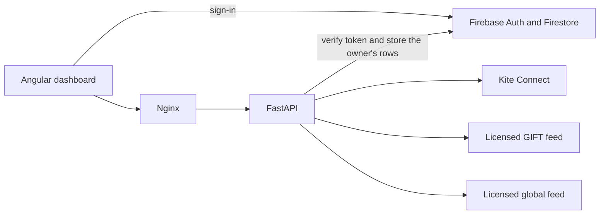

# TradingEngineAI specification

Status: source of truth for implementation. Checked against public Zerodha, NSE, and NSE IX descriptions on **2026-11-13**. Session clocks and vendor plan names change by circular. Before Phases 4 and 5, re-read the sources in [References](#references) and record any difference in `buildOrder.md`.

Product name: **TradingEngineAI**. Repository name: **Morning-algo**. Audience: the Zerodha account owner, running a private dashboard.

## 1. Purpose

The application helps that owner look at, before 09:15 IST:

- an expected opening direction for Nifty 50 and for Sensex
- a gap-up, gap-down, and flat heuristic score
- GIFT Nifty movement
- the latest completed US cash session and the Asian session then in progress

After the cash open it replaces expected opens with official opens when a licensed feed provides them, computes the opening gap, tracks the 5-minute and 15-minute opening ranges, computes VWAP when volume is usable, and labels an intraday bias.

The product is analytical decision support.

### 1.1 In scope

- A private dashboard for one allowlisted Firebase user, expandable only under the licensing rule in [§3](#3-licensing-and-tenancy).
- Read-only market data through official or licensed APIs.
- A transparent, configurable scoring model.
- Persistence of the owner’s own snapshots, scores, and settings.
- Docker deployment behind Nginx.

### 1.2 Out of scope

- Order placement, modification, cancellation, GTT, baskets, or alerts.
- Any automatic CE or PE order.
- Fully automated trading. Zerodha’s API terms require exchange approval for unattended automation; this product does not seek that approval and does not call order endpoints.
- Public or multi-tenant display of Kite Connect quotes.
- Scraping NSE, BSE, NSE IX, or other sites that disallow automated access.
- A claim that a score is a statistically calibrated probability, until the gate in [§8.6](#86-calibration-gate) passes.
- Invented prices, invented VIX, or invented pre-open prints.

## 2. Repository baseline

As of the specification commit, the repository contains this document, `docs/CURSOR_IMPLEMENTATION_PROMPT.md`, `buildOrder.md`, and `README.md`. There is no application code, no framework convention, and no runtime to preserve. New code follows the layout in [§5](#5-repository-layout).

## 3. Licensing and tenancy

These rules constrain the architecture. A convenient API shape loses to them.

### 3.1 Kite Connect

Zerodha’s published plans, read 2026-11-13:

| Plan | Price | Market data |
| --- | --- | --- |
| Personal | Free | Orders, GTT, alerts, margins, portfolio. No live market data, no WebSocket market stream, no historical candles. |
| Connect | ₹500 per API key per month | Personal features plus live WebSocket market data and historical candles. Both data rights are included in that subscription. |

From October 2026 Zerodha has also described brokerage-linked developer credits that can offset the next month’s ₹500. Eligibility thresholds have already been revised once (a developer-forum note of 3 November 2026 cites a change to ₹500 brokerage effective 5 November 2026). Treat credits as a billing detail, not as an entitlement the software checks. The software checks whether the key can actually read market data.

Kite Connect terms and Zerodha’s support articles say live market data from the API is not for display to the public, and that displaying or redistributing it on other platforms conflicts with exchange data-vending policy. A Zerodha staff reply on the developer forum allows a private, non-shared personal dashboard for the client’s own account.

Consequences for this codebase:

- Default deployment is **single owner**. `ALLOWED_UIDS` contains that Firebase uid.
- Kite quotes, candles, and derived opening range or VWAP that use those quotes are stored only under `users/{uid}/...` for the uid whose Kite session produced them.
- The Angular app never receives `api_key`, `api_secret`, or `access_token`.
- The service never writes those secrets into Firestore documents the client SDK can read.
- Shared collections of Kite-derived prices are not part of the design.
- A future multi-user mode requires a separate, exchange-authorised data vendor and a provider implementation that does not call Kite for other users’ screens. That mode is out of scope until a written vendor licence is configured.

### 3.2 GIFT Nifty and global indices

GIFT Nifty (NSE IX Nifty 50 index futures, the successor to SGX Nifty) needs a licensed or otherwise authorised feed. The default provider is unconfigured and returns `unavailable`. The HTTP adapter talks only to a base URL the operator supplies. The project ships no scraper and no unofficial HTML parser.

Global indices use the same pattern. A vendor such as the operator’s licensed terminal API, or a commercial REST vendor whose terms allow this private display, is wired through `GlobalIndicesProvider`. The adapter is off until its credentials are present.

### 3.3 What the UI is allowed to call a price

Every numeric market field has a status:

| Status | Meaning |
| --- | --- |
| `ok` | Parsed from the named source, inside the freshness window. |
| `stale` | Parsed from the named source, older than the freshness window. The number may be shown with a stale badge. The scorer treats it as missing. |
| `unavailable` | No usable value. `value` is null. `reason` explains why. |

`value` is null whenever status is `unavailable`. Production configuration has no fixture provider. Tests may use fixtures only when `APP_ENV=test`, and those payloads set `fixture: true`.

## 4. Market clock

All user-facing times use `Asia/Kolkata`. Persisted timestamps are UTC. The trading date is the IST calendar date.

### 4.1 Cash session

Sources disagree on the internal pre-open cutover, so the cutover is configuration, not a scattered literal.

- NSE’s pre-open page describes a 15-minute pre-open from 09:00 to 09:15 IST: order entry 09:00–09:05 for limit and market orders, 09:05–09:10 for limit orders only, matching about 09:10–09:12, buffer 09:12–09:15.
- NSE’s market-timings page, marked updated 11 November 2026, still lists regular pre-open close at 09:08 and normal market open at 09:15.
- An October 2026 NSE FAQ PDF shows the 09:08 matching start as the then-current time and the 09:10 start as the revised time.

What is stable, and what the product depends on: **regular pre-open starts at 09:00 IST and normal trading starts at 09:15 IST.** The opening price is the exchange’s equilibrium print from that discovery process. Index values are calculated from constituents. There is no separate official “Nifty pre-open auction price” that this app should invent. A field may be called indicative only when a licensed feed marks it as indicative, and the payload records that distinction.

Configurable defaults (`Asia/Kolkata`):

| Key | Default | Meaning |
| --- | --- | --- |
| `PREOPEN_START` | 09:00 | Pre-open order collection begins. |
| `PREOPEN_MATCHING_START` | 09:10 | Align this to the latest NSE circular before go-live. |
| `PREOPEN_BUFFER_START` | 09:12 | Buffer before continuous trading. |
| `CASH_OPEN` | 09:15 | Normal market open. Official open may be published here. |
| `OR_5_END` | 09:20 | End of the 5-minute opening range. |
| `OR_15_END` | 09:30 | End of the 15-minute opening range. Confirmation checkpoint. |
| `CASH_CLOSE` | 15:30 | Normal cash close. |

BSE’s own pre-open is a different timetable. Sensex indicative values come from a BSE-capable licensed feed or stay `unavailable`. The app does not copy the Nifty indication onto Sensex.

### 4.2 GIFT Nifty session

NSE IX extended the Nifty 50 futures timetable effective **2 November 2026**. Secondary write-ups of the exchange’s circulars describe:

- morning pre-open about 05:00 IST
- session 1 normal trading **05:15–15:40 IST**
- a pre-close window after 15:40
- session 2 normal trading **16:05–02:45 IST** the next morning

Older articles still say session 1 starts at 06:30. The implementation reads `GIFT_SESSION1_OPEN` (default `05:15`) from configuration and shows that value in the source-status panel so an operator can correct it without a code change.

The product timeline keeps the operator checkpoints the dashboard is built around. 08:00 is a review checkpoint during session 1, not the GIFT open.

| Checkpoint (IST) | Product meaning |
| --- | --- |
| 05:15 | GIFT session 1 is expected to be in its normal trading window. Monitoring can already have started. |
| 08:00 | Operator checkpoint: GIFT Nifty review. |
| 08:30 | Operator checkpoint: US cash close plus Asian markets. |
| 09:00 | NSE regular pre-open starts. |
| 09:15 | Cash open. Expected opens are replaced when the official open arrives. |
| 09:30 | 15-minute opening-range confirmation checkpoint. |

### 4.3 US cash close used in the India morning

At 08:00 IST the US cash session is already over. The US inputs are the **latest completed regular-session percent changes** for Nasdaq Composite (or Nasdaq-100, chosen by `US_NASDAQ_SYMBOL` and held fixed), Dow Jones Industrial Average, and S&P 500. The payload says `session_state: closed` and names the US trading date. Those values are fresh for the India morning. They become stale only when a newer completed US session exists and the feed still shows the older one.

Asia inputs (Nikkei 225, Hang Seng) use the vendor’s live or last price and a short freshness window (default 60 seconds) while those sessions are open.

### 4.4 Session status enum

The header computes one status from the clock and the configured timetable:

`pre_gift_review` · `gift_monitoring` · `global_review` · `nse_preopen` · `opening_drive` · `cash_session` · `closed` · `weekend`

`opening_drive` is 09:15–09:30 IST. Weekend uses the IST weekday. Exchange holidays are an optional date list in `MARKET_HOLIDAYS`. An empty list means “weekday timetable only”, and the header shows that holiday coverage is not loaded.

## 5. Architecture and repository layout

The browser talks only to Nginx. Nginx serves the Angular build and proxies `/api/` and `/ws/` to FastAPI. FastAPI is the only component that holds Kite and vendor credentials. It verifies the Firebase ID token, reads and writes the signed-in user’s Firestore documents with the Admin SDK, and calls market providers. Providers that are not configured return an empty quote. They do not block the others.



Firestore is not on the market-data path for the live card. The live card is the provider response. Firestore stores the owner’s history so Phase 9 can calibrate later.

```
frontend/                  Angular 22 workspace
  src/app/
    core/                  auth, api client, clock, session status
    features/dashboard/    page and feature components
    shared/                quote card, score badge, status chip
  Dockerfile
backend/
  app/
    main.py
    api/v1/                routers
    schemas/               Pydantic models
    services/
      prediction_engine.py
      opening_range.py
      vwap.py
      session_clock.py
    providers/
      base.py
      kite_market.py
      gift_nifty.py
      global_indices.py
    db/firestore.py
    auth/firebase.py
    ws/market.py
  tests/
  Dockerfile
deploy/
  nginx.conf
firebase/
  firestore.rules
  firestore.indexes.json
docker-compose.yml
.env.example
.dockerignore
```

Versions to pin at implementation time, then lock:

- Angular **22.x** current stable (22.2.6 on 2026-11-12) and the matching Angular Material.
- TypeScript version the Angular 22 CLI selects.
- Standalone components, SCSS, routing on, SSR off.
- `lightweight-charts` **5.x** (the Apache-2.0 library), not the TradingView embeddable widget.
- Python **3.12** in the image. FastAPI **0.162.x** (0.162.5 on 2026-11-11) and Pydantic v2.
- Official PyPI package `kiteconnect`.
- `firebase-admin` on the server and the modular Firebase JS SDK in Angular.

## 6. Configuration

Environment variables are the only secret channel. `.env.example` lists every key with an empty value and a comment. Real `.env`, service-account JSON, and Kite token files match `.gitignore` and `.dockerignore`.

| Variable | Required | Notes |
| --- | --- | --- |
| `APP_ENV` | yes | `development`, `test`, or `production`. |
| `ALLOWED_ORIGINS` | yes | Comma-separated CORS origins. |
| `ALLOWED_UIDS` | yes in production | Comma-separated Firebase uids. |
| `FIREBASE_PROJECT_ID` | yes | |
| `FIREBASE_SERVICE_ACCOUNT_FILE` | yes on the server | Path inside the container, mounted as a secret, not baked into the image. |
| `KITE_API_KEY` | no | Empty means Kite is unconfigured. |
| `KITE_API_SECRET` | no | Server only. |
| `KITE_REDIRECT_URL` | no | Backend callback. |
| `KITE_ACCESS_TOKEN` | no | Optional boot token. Prefer the login callback. Never logged. |
| `GIFT_NIFTY_BASE_URL` | no | Empty means unavailable. |
| `GIFT_NIFTY_API_TOKEN` | no | Sent as a header, never logged. |
| `GLOBAL_INDICES_BASE_URL` | no | |
| `GLOBAL_INDICES_API_TOKEN` | no | |
| `SCORE_FLAT_BAND` | no | Default `0.15` on the raw score. |
| `GAP_FLAT_ABS_PERCENT` | no | Default `0.15` percentage points. |
| `CONFIDENCE_CAP_UNCALIBRATED` | no | Default `0.75`. |
| `GIFT_STALE_SECONDS` | no | Default `15` during session 1. |
| `ASIA_STALE_SECONDS` | no | Default `60`. |
| `PREOPEN_MATCHING_START` | no | Default `09:10`. |
| `MARKET_HOLIDAYS` | no | Comma-separated `YYYY-MM-DD` IST dates. |

Feature weights live in `backend/app/config/weights.yaml` so a change is reviewable. Defaults are in [§8.3](#83-default-weights).

## 7. HTTP API

Base path `/api/v1`. JSON. Authenticated routes require `Authorization: Bearer <Firebase ID token>` except `GET /api/v1/health`.

Swagger UI at `/docs` and the OpenAPI schema at `/openapi.json` are part of the deliverable. Descriptions in the schema repeat the experimental-score wording so generated clients do not rename scores into probabilities.

### 7.1 Error envelope

Used for 4xx and 5xx. Field-level market gaps are not errors; they are `unavailable` inside a 200 body.

```json
{
  "error": {
    "code": "UNAUTHENTICATED",
    "message": "A valid Firebase ID token is required.",
    "request_id": "req_01HZZ",
    "timestamp": "2026-11-13T02:45:00Z"
  }
}
```

| HTTP | Code | When |
| --- | --- | --- |
| 401 | `UNAUTHENTICATED` | Missing or invalid Firebase token, including the WebSocket. |
| 403 | `FORBIDDEN` | Token is valid and the uid is outside `ALLOWED_UIDS`. |
| 422 | `VALIDATION_ERROR` | Pydantic rejects the query. `message` lists the fields. |
| 404 | `NOT_FOUND` | Unknown prediction id or trading date. |
| 429 | `RATE_LIMITED` | Over 60 REST requests per uid per minute. |
| 503 | `SERVICE_UNAVAILABLE` | The process cannot answer at all, such as a broken Firestore client on a route that must read it. A down market vendor is not a 503. |

`request_id` is echoed in logs. Logs contain path, status, uid, and provider name. Logs omit authorization headers, Kite tokens, vendor tokens, and service-account contents.

### 7.2 Shared shapes

Timestamps are ISO-8601 UTC. Prices are decimals serialized as strings in JSON so the client does not pick up binary float noise. The Python type is `decimal.Decimal`. Percents are strings with a sign and four decimal places, in percentage points.

```python
class DataStatus(str, Enum):
    ok = "ok"
    stale = "stale"
    unavailable = "unavailable"

class Quote(BaseModel):
    status: DataStatus
    value: Decimal | None = None
    previous_reference: Decimal | None = None
    change: Decimal | None = None
    change_percent: Decimal | None = None
    as_of: datetime | None = None
    source: str | None = None
    reason: str | None = None
    fixture: bool = False
```

`source` is a stable provider id (`kite`, `gift_http`, `global_http`), not a secret.

### 7.3 `GET /api/v1/health`

No auth. Body:

```json
{
  "status": "ok",
  "version": "0.1.0",
  "time": "2026-11-13T02:45:00Z",
  "timezone": "Asia/Kolkata",
  "checks": {
    "process": "ok",
    "firestore": "ok",
    "kite": "unconfigured",
    "gift_nifty": "unconfigured",
    "global_indices": "unconfigured"
  }
}
```

Provider checks are `ok`, `unconfigured`, or `down`. A `down` check still returns HTTP 200 from `/health` so the container stays up while a vendor is quiet. Docker’s process health uses this route. Detail strings from vendor exceptions are not copied into the body.

### 7.4 `GET /api/v1/market/overview`

One payload for the header cards.

```json
{
  "trading_date": "2026-11-13",
  "as_of": "2026-11-13T02:45:00Z",
  "session_status": "gift_monitoring",
  "gift_nifty": { "status": "unavailable", "value": null, "reason": "GIFT_NIFTY_BASE_URL is not set." },
  "nifty50": {
    "previous_close": { "status": "unavailable", "value": null, "reason": "Kite is not configured." },
    "indicative_open": {
      "status": "unavailable",
      "value": null,
      "kind": "unavailable",
      "reason": "No licensed indicative feed is configured."
    },
    "official_open": { "status": "unavailable", "value": null, "reason": "Cash session has not published an open." }
  },
  "sensex": { "previous_close": {}, "indicative_open": {}, "official_open": {} }
}
```

`indicative_open.kind` is `exchange_published`, `vendor_indicative`, or `unavailable`. The scorer ignores any other kind. The UI prints “Indicative” only for `vendor_indicative` and “Exchange” only for `exchange_published`.

### 7.5 `GET /api/v1/market/gift-nifty`

Returns the `Quote` plus `session_name` (`session_1`, `session_2`, or `closed`) and `reference_label` (for example `previous_close` or `prior_settlement`, copied from the vendor mapping, never guessed).

### 7.6 `GET /api/v1/market/global-indices`

```json
{
  "as_of": "2026-11-13T02:45:00Z",
  "indices": [
    {
      "id": "spx",
      "name": "S&P 500",
      "session_state": "closed",
      "session_date": "2026-11-12",
      "quote": { "status": "ok", "change_percent": "0.4200" }
    }
  ],
  "summary": {
    "text": "US cash session close is available for 2026-11-12. Asian quotes are unavailable because GLOBAL_INDICES_BASE_URL is not set.",
    "score_kind": "descriptive",
    "inputs_used": ["spx"]
  }
}
```

Required ids: `nasdaq`, `djia`, `spx`, `nikkei225`, `hangseng`. Missing ids are present with `status: unavailable`. The summary is a deterministic template. It does not call a language model. It does not use the words “probability” or “signal”.

### 7.7 `GET /api/v1/market/pre-open`

Returns Nifty and Sensex indicative opens using the same `kind` field, plus `phase` computed by `session_clock` (`order_entry`, `matching`, `buffer`, `continuous`, `outside`).

### 7.8 `GET /api/v1/predictions/latest`

Query: `instrument=NIFTY50|SENSEX` optional. Omitted returns both.

```json
{
  "predictions": [
    {
      "prediction_id": "01J...",
      "trading_date": "2026-11-13",
      "instrument": "NIFTY50",
      "direction": "GREEN",
      "gap_up_score": "0.62",
      "gap_down_score": "0.18",
      "flat_score": "0.20",
      "score_kind": "experimental_heuristic",
      "calibrated": false,
      "confidence": "0.48",
      "confidence_meaning": "feature_coverage_and_freshness",
      "model_version": "heuristic-1",
      "data_quality": "partial",
      "explanation": [
        { "feature": "gift_nifty_change", "contribution": "0.24", "note": "GIFT Nifty +0.60% versus its configured reference." }
      ],
      "created_at": "2026-11-13T02:50:00Z",
      "inputs_as_of": "2026-11-13T02:49:50Z"
    }
  ]
}
```

`direction` is `GREEN`, `RED`, `FLAT`, or `UNKNOWN`. `UNKNOWN` is used when no feature is available. Scores are null in that case.

While `calibrated` is false the schema has scores and has no `gap_up_probability`, `gap_down_probability`, or `flat_probability`. Those three fields appear only after the calibration gate flips `score_kind` to `calibrated_probability`. The UI copy for the experimental kind is: “Experimental heuristic score. This is not a statistically validated probability.”

### 7.9 `GET /api/v1/predictions/history`

Query: `instrument`, `from`, `to` as IST dates, `limit` default 30, maximum 180. Ordered by `created_at` descending. Only the caller’s documents.

### 7.10 `GET /api/v1/market/intraday`

Query: `instrument=NIFTY50|SENSEX`, `interval=1m|5m`, `trading_date` optional (default today IST).

```json
{
  "instrument": "NIFTY50",
  "interval": "1m",
  "trading_date": "2026-11-13",
  "source": "kite",
  "candles": [
    { "time": "2026-11-13T03:45:00Z", "open": "24100.00", "high": "24110.50", "low": "24090.00", "close": "24105.00", "volume": "0" }
  ],
  "status": "ok"
}
```

An empty candle list with `status: unavailable` is the Personal-plan and pre-open response. Candles before 09:15 IST are not synthesised.

### 7.11 `GET /api/v1/market/opening-range`

Query: `instrument`, `trading_date` optional.

Returns `range_5m` and `range_15m`, each `{ status, high, low, ready_at }`. Before the window ends, status is `unavailable` with reason `window_open`. A missing candle inside the window yields `unavailable` with reason `incomplete_candles`. The service does not fill gaps with neighbouring prices.

### 7.12 `GET /api/v1/market/vwap`

Session VWAP from 09:15 IST:

`typical = (high + low + close) / 3`

`VWAP = sum(typical * volume) / sum(volume)` over completed 1-minute candles.

If every volume is 0 or null, status is `unavailable` and reason is `index_volume_absent`. The service does not fall back to a simple average and still call it VWAP. Many index candles legitimately have zero volume; that outcome is expected and must be visible.

### 7.13 WebSocket `GET /ws/market`

The browser sends the Firebase ID token on the first message: `{ "type": "auth", "token": "<id token>" }`. The server has 5 seconds to see a valid allowlisted token, otherwise it closes with code `4401`.

Server messages, at most once per second per connection:

```json
{
  "type": "snapshot",
  "as_of": "2026-11-13T03:46:01Z",
  "overview": {},
  "prediction": {},
  "bias": {},
  "opening_range": {},
  "vwap": {}
}
```

The snapshot reuses the REST schemas. One connection per uid; a new connection closes the previous one. The server does not forward raw Kite binary frames.

REST and the socket share a token-bucket limit. The socket counts as one REST-equivalent request per snapshot pushed, and a uid over the limit receives `{ "type": "rate_limited" }` then a close code `4429`.

## 8. Prediction engine

Module: `backend/app/services/prediction_engine.py`. Pure function plus a thin service that loads inputs. The pure function takes a clock and a feature dict so tests do not touch the network.

### 8.1 Inputs

| Feature id | Source | Missing behaviour |
| --- | --- | --- |
| `gift_nifty_change` | GIFT quote `change_percent`, status `ok` only | Drop the feature |
| `us_session` | Mean of available `ok` percent changes among nasdaq, djia, spx | Drop if none are `ok` |
| `asia_session` | Mean of available `ok` percent changes among nikkei225, hangseng | Drop if none are `ok` |
| `india_vix_level` | Kite quote for `NSE:INDIA VIX` when status is `ok` | Skip the confidence penalty |
| `india_vix_change` | Percent change of that quote when status is `ok` | Drop the feature |
| `nifty_previous_close` | Kite previous close | Required only for the post-open gap math, not for the pre-open score |
| `sensex_previous_close` | Kite previous close | Same |
| `preopen_indicative` | Indicative open whose `kind` is `exchange_published` or `vendor_indicative` | Drop the feature |
| `overnight_event` | Optional manual flag on `user_settings` for the trading date: `risk_off`, `risk_on`, or unset | Drop when unset |

Historical gap frequencies are **not** an input of `heuristic-1`. They enter in Phase 9 as a calibration report. Putting an uncomputed frequency into the live score would pretend to a history the install does not have.

There is no news scraper and no default event feed. `overnight_event` is set by the signed-in user in settings, or it is absent.

### 8.2 Normalisation

Percent features convert to a clipped unit value.

```
unit(percent, scale) = clip(percent / scale, -1, 1)
```

| Feature | Scale (percentage points) |
| --- | --- |
| `gift_nifty_change` | 1.0 |
| `us_session` | 1.5 |
| `asia_session` | 1.5 |
| `india_vix_change` | 5.0 |
| `preopen_indicative` | The indicative gap percent versus previous close, scale 1.0 |

`overnight_event` maps `risk_on` to `+1`, `risk_off` to `-1`.

India VIX level does not push direction. It reduces confidence when the level is at or above `VIX_ELEVATED` (default 20).

### 8.3 Default weights

Renormalise across the features that are present. A missing feature drops its weight from both the numerator and the denominator.

| Feature | Weight |
| --- | --- |
| `gift_nifty_change` | 0.40 |
| `us_session` | 0.25 |
| `asia_session` | 0.15 |
| `preopen_indicative` | 0.12 |
| `india_vix_change` | 0.05 |
| `overnight_event` | 0.03 |

```
raw = sum(weight_i * unit_i) / sum(weight_i)
```

`raw` is in `[-1, 1]`.

Direction for the pre-open card, with `SCORE_FLAT_BAND` default `0.15`:

- `GREEN` when `raw >= 0.15`
- `RED` when `raw <= -0.15`
- `FLAT` otherwise

Sensex uses the same raw score in `heuristic-1`, because the specified inputs are market-wide. The explanation says so. Sensex gets its own pre-open feature only when a Sensex indicative quote exists; otherwise the card shows the shared score and the line “Sensex-specific pre-open input was unavailable.”

### 8.4 Score shares

These three numbers sum to 1. They are a fixed transform of `raw` for display. They are not trained frequencies.

```
gap_up_raw    = exp(raw / T)
gap_down_raw  = exp(-raw / T)
flat_raw      = exp(-abs(raw) / T)
T             = 0.75
```

Divide each by the sum of the three. Round each share to two decimal places with half away from zero. If the rounded shares do not sum to `1.00`, add or subtract `0.01` from the largest share. Ties break in the order gap-up, then gap-down, then flat. The API always presents shares that sum to `1.00`.

`confidence` starts from feature coverage:

```
coverage   = sum(present weights) / sum(all weights)
confidence = min(CONFIDENCE_CAP_UNCALIBRATED, 0.20 + 0.70 * coverage)
```

Then, if India VIX level is `ok` and `>= 20`, multiply confidence by `0.85`. If any present feature was excluded for staleness, multiply by `0.90` once. Floor at `0.00`. Round to two decimal places.

The confidence field means coverage and freshness. The API sets `confidence_meaning` to `feature_coverage_and_freshness` so a client cannot relabel it as a hit rate.

### 8.5 Worked example

Inputs, all fresh: GIFT Nifty `+0.60%`, US mean `+0.30%`, Asia mean `-0.20%`, no pre-open indication, India VIX change `-1.00%`, VIX level `14`, no overnight flag.

| Feature | Unit | Weight | Product |
| --- | --- | --- | --- |
| gift | 0.60 | 0.40 | 0.240 |
| us | 0.20 | 0.25 | 0.050 |
| asia | -0.1333 | 0.15 | -0.0200 |
| vix change | -0.20 | 0.05 | -0.010 |

Present weight sum = 0.85. `raw = 0.260 / 0.85 = 0.3059`. Direction `GREEN`.

Coverage = 0.85. `confidence = min(0.75, 0.20 + 0.70 * 0.85) = min(0.75, 0.795) = 0.75`.

Unrounded shares are `0.5306`, `0.2347`, and `0.2347`. After half-away-from-zero rounding they are `0.53`, `0.23`, and `0.23` (sum `0.99`). The largest share moves by `0.01`, so the published strings are:

| Field | Value |
| --- | --- |
| `gap_up_score` | `0.54` |
| `gap_down_score` | `0.23` |
| `flat_score` | `0.23` |
| `confidence` | `0.75` |
| `direction` | `GREEN` |

Tests assert `raw` at four decimal places (`0.3059`) and these five published strings. Positive `raw` makes the unrounded gap-down and flat shares equal; that is a property of the transform.

All features missing: `direction = UNKNOWN`, scores null, `confidence = 0.00`, `data_quality = none`.

`data_quality` is `full` when every weight is present, `partial` when some are present, `none` when none are.

### 8.6 Calibration gate

Phase 9 compares stored pre-open scores with the later official gap:

```
gap_percent = (official_open - previous_close) / previous_close * 100
```

Category, with `GAP_FLAT_ABS_PERCENT` default `0.15`:

- gap-up when `gap_percent >= 0.15`
- gap-down when `gap_percent <= -0.15`
- flat when `abs(gap_percent) < 0.15`

The 0.15 point threshold is a product setting. It is not an exchange definition of a gap.

`score_kind` may become `calibrated_probability` only when all of the following hold for that instrument:

- at least 120 completed sessions with `data_quality` of `full` or `partial` and an official open
- Brier score of the three-way score against the realised category is **at or below 0.22**
- the report is committed under `model_version` and the live process is configured with `MODEL_VERSION` pointing at it

Until then the live model version remains `heuristic-1` and `calibrated` remains false. The backtest job writes a report. It does not rewrite weights by itself.

### 8.7 Post-open confirmation

From 09:15 IST, overview fields prefer `official_open` when its status is `ok`. The pre-open prediction document is kept. A new document `intraday_analysis` records the actual gap and the bias. The UI shows both, with the actual gap labeled “Realised opening gap”.

Options bias, computed by `services/intraday_bias.py`:

| Condition | `options_bias` |
| --- | --- |
| Before 09:15 IST | `WAIT` |
| 15-minute range not `ok`, or VWAP not `ok` | `WAIT` |
| Last price above the 15-minute high and above VWAP | `CE` |
| Last price below the 15-minute low and below VWAP | `PE` |
| Otherwise | `WAIT` |

`trend` is `bullish` for `CE`, `bearish` for `PE`, and `neutral` for `WAIT`. The payload includes `rule_id: or15_vwap_v1` and the human sentence that matched. The 5-minute range is displayed as soon as it is ready and does not by itself change `options_bias`.

Every bias payload includes:

`risk_warning`: “This screen is decision support for the signed-in account owner. Scores are not guaranteed outcomes. CE, PE, and WAIT are labels, and this application does not place orders.”

## 9. Providers

Each provider implements one protocol and returns schemas from [§7](#7-http-api). Exceptions are caught at the router boundary, logged with `provider` and `exception_class`, and mapped to `unavailable`.

### 9.1 Kite

`KiteMarketDataProvider` uses the official `kiteconnect` package.

Used calls, and only these:

- login URL and `generate_session` on the server callback
- `instruments` dump for NSE and BSE
- `quote` or `ltp` plus `ohlc` for `NSE:NIFTY 50`, `BSE:SENSEX`, `NSE:INDIA VIX`
- `historical_data` for 1-minute candles
- `KiteTicker` subscribe for those three tokens in Phase 7

Unused on purpose: `place_order`, `modify_order`, `cancel_order`, GTT, margins, and positions. Code review rejects a diff that imports them.

Instrument tokens are read from the dump on startup and again at 08:00 IST. Well-known values are a fallback only when the dump cannot be fetched, and the source status then says `instrument_dump_unavailable_using_fallback`:

| Symbol | Fallback token |
| --- | --- |
| `NSE:NIFTY 50` | 256265 |
| `BSE:SENSEX` | 265 |
| `NSE:INDIA VIX` | 264969 |

If the dump loads, the dump wins even when it disagrees with this table.

A Personal key that returns an insufficient-permission error maps to reason `kite_plan_lacks_market_data`. The paid plan is what provides live ticks and historical candles.

Access tokens expire daily. The server stores the current token in memory and, if `KITE_TOKEN_FILE` is set, in that file with mode `0600`. The file lives on a Docker volume that is not in the image. Firestore does not store it.

### 9.2 GIFT Nifty

```python
class GiftNiftyProvider(Protocol):
    name: str
    async def quote(self) -> Quote: ...
```

Implementations:

- `UnconfiguredGiftNiftyProvider`, the default
- `HttpGiftNiftyProvider`, which GETs `{GIFT_NIFTY_BASE_URL}` with the bearer token, timeout 3 seconds, and accepts only this JSON:

```json
{
  "price": "24350.50",
  "reference": "24200.00",
  "reference_label": "previous_close",
  "as_of": "2026-11-13T02:49:50Z"
}
```

The adapter computes change and change percent. It rejects non-numeric prices, a missing `as_of`, and an `as_of` older than `GIFT_STALE_SECONDS` by returning `stale` or `unavailable` rather than a repaired number.

### 9.3 Global indices

`GlobalIndicesProvider` returns the five required ids. `HttpGlobalIndicesProvider` accepts a JSON array of `{ id, price, previous_close, session_state, session_date, as_of }`. Unknown ids are ignored. Missing required ids become `unavailable`. The US `session_state` must be `closed` during the India pre-open window; a vendor payload that says `open` at 08:30 IST is rejected as `unavailable` with reason `unexpected_session_state`, because the morning model is defined on the completed US cash close.

## 10. Firestore

Server writes use `firebase-admin`. The Angular client may read only the paths the rules allow. The client does not write market or prediction documents.

### 10.1 Paths

```
users/{uid}
  email, display_name, created_at
user_settings/{uid}
  score_flat_band_override (optional), overnight_event_by_date (map of YYYY-MM-DD to risk_on|risk_off)
users/{uid}/predictions/{prediction_id}
users/{uid}/market_snapshots/{snapshot_id}
users/{uid}/global_market_snapshots/{snapshot_id}
users/{uid}/intraday_analysis/{trading_date}
users/{uid}/provider_status/{provider_id}
```

`prediction_id` is a ULID. Prediction fields match [§7.8](#78-get-apiv1predictionslatest) plus `input_features`, a map of feature id to `{ value, unit, weight, status }`.

`created_at` and `as_of` are Firestore timestamps in UTC. `trading_date` is a string `YYYY-MM-DD` in IST.

Snapshots store the same quote objects the API returns, for the owner’s later calibration. They are not a shared cache.

### 10.2 Rules

`firebase/firestore.rules` implements:

- `request.auth.uid == uid` on every user-scoped path
- client create, update, and delete denied on predictions, snapshots, intraday analysis, and provider status
- client write on `user_settings/{uid}` allowed only for the owner, and only for the two setting keys named above
- any document that contains `api_key`, `api_secret`, `access_token`, or `kite` secret-shaped keys is denied on write

### 10.3 Indexes

Composite index on `users/{uid}/predictions`: `instrument` ascending, `trading_date` descending, `created_at` descending. Declared in `firebase/firestore.indexes.json`.

## 11. Angular UI

Dark theme. Angular Material with a custom dark palette: background `#0f1419`, surface `#1a2332`, text `#e7ecf3`, green `#1f8a70`, red `#c44536`, flat/neutral `#c4a35a`. Type is a compact UI sans (Roboto is acceptable). Cards use the same `QuoteCard` shell.

### 11.1 Components

| Component | Responsibility |
| --- | --- |
| `DashboardComponent` | Page grid, loads overview, predictions, globals, bias. Owns the socket. |
| `MarketOverviewComponent` | Previous close, indicative open, official open for both indices. |
| `GiftNiftyCardComponent` | Price, change, percent, reference label, session name. |
| `NiftyPredictionCardComponent` | Direction, three scores, confidence, experimental badge, timestamp. |
| `SensexPredictionCardComponent` | Same, plus the Sensex-specific input line. |
| `GlobalMarketsComponent` | Five indices and the descriptive summary. |
| `SentimentScoreComponent` | Shared score presentation used by both prediction cards. |
| `IntradayBiasComponent` | Bullish, bearish, or neutral; CE, PE, or WAIT; explanation; risk warning. |
| `MarketChartComponent` | Lightweight Charts wrapper. Inputs are candles or a line series. |
| `OpeningRangeComponent` | 5-minute and 15-minute high and low. |
| `VwapIndicatorComponent` | VWAP value and status, including the zero-volume reason. |
| `MarketTimelineComponent` | The checkpoints in [§4.2](#42-gift-nifty-session), highlighting the active one. |
| `DataSourceStatusComponent` | Each provider: ok, stale, unconfigured, down. Last success time in IST. |

Feature components receive inputs. They do not call HTTP themselves. `DashboardComponent` and a single `MarketApi` service own I/O.

### 11.2 Header

Left: wordmark “TradingEngineAI”. Right: IST clock updating every second, session status, data `as_of` in IST, socket state `connected` / `connecting` / `disconnected`.

### 11.3 Charts

Three chart slots:

1. GIFT Nifty line, from stored or live quotes of that provider.
2. Nifty 1-minute candles once the cash session has candles.
3. Sensex 1-minute candles on the same rule.

Opening-range high and low are price lines on the cash charts when the range status is `ok`. VWAP is a line series only when VWAP status is `ok`. Volume is a histogram only when at least one candle has volume greater than zero; otherwise the volume pane is omitted and the VWAP card explains why.

### 11.4 Responsive behaviour

At `>= 1024px` the overview cards sit in one row and the charts sit on a 12-column grid. Below that, cards stack in the order: GIFT, Nifty prediction, Sensex prediction, global markets, bias, charts, timeline, sources. The 390px width shows the experimental badge and the risk warning without horizontal scrolling.

### 11.5 Auth screens

Email and password, and Google, via Firebase Authentication. After sign-in the app attaches the ID token to REST calls and to the socket hello. A 403 allowlist rejection shows: “This private dashboard is not enabled for this account.”

## 12. Security

- Firebase Authentication on the client.
- `firebase-admin` token verification on every REST route except health, and on the socket hello.
- CORS limited to `ALLOWED_ORIGINS`. Credentials are not reflected to `*`.
- Rate limit stated in [§7.1](#71-error-envelope).
- Secrets only through the environment and the token file in [§9.1](#91-kite).
- Structured logs without those secrets.
- Firestore rules in [§10.2](#102-rules).
- Nginx forwards `Authorization` and upgrades `WebSocket`. It does not log request headers.
- Security response headers from Nginx: `X-Content-Type-Options: nosniff`, `Referrer-Policy: no-referrer`, and a content security policy that allows the app origin, Firebase Auth endpoints, and no other script hosts.

## 13. Docker

`docker-compose.yml` services:

| Service | Image | Notes |
| --- | --- | --- |
| `backend` | local Dockerfile, Python 3.12, `uvicorn app.main:app` | Health check hits `/api/v1/health`. Restart `unless-stopped`. |
| `frontend` | multi-stage Node build, then Nginx | Serves the Angular build and proxies `/api/` and `/ws/` to `backend`. |
| volume `kite_tokens` | | Mounted only on `backend` at the token-file path. |
| volume `backend_logs` | | `/var/log/tradingengine`. |

Compose reads `.env` and does not define secret defaults. The production frontend build uses `ng build` with `output: 'browser'` as the Angular 22 application builder emits. Nginx `try_files` falls back to `index.html` for the Angular router.

Health checks use `wget` or `curl` against the public port for the frontend and against the backend route directly. Both containers expose logs to the volume or to the Docker log driver. Restart policy is `unless-stopped` on both.

`.dockerignore` excludes `.git`, `.env`, `**/*serviceAccount*.json`, `**/tokens`, `**/__pycache__`, `frontend/node_modules`, and `frontend/dist`.

## 14. Testing

### 14.1 Backend

`pytest`, `pytest-asyncio`, `httpx.AsyncClient`, and a frozen clock (`time-machine` or equivalent).

Required tests:

- Prediction engine: the worked example, a bearish mirror, a flat band inside `±0.15`, all-missing, one-feature renormalisation, VIX confidence penalty, stale input excluded.
- Gap categorisation at exactly `±0.15` and just inside the flat band.
- Timezone: a UTC instant just before and just after 18:30 UTC maps to the correct IST trading date. US session date at 08:30 IST refers to the completed US date, including a US daylight-saving week.
- Providers: unconfigured, HTTP 500, malformed JSON, stale `as_of`, Personal-plan permission error, dump token preferred over fallback.
- API: 401, 403, 422, partial overview when GIFT throws, health body free of secret-looking keys.
- Opening range incomplete window. VWAP with zero volume. VWAP with a known two-candle hand calculation.
- Bias stays `WAIT` at 09:14:59 IST and follows `or15_vwap_v1` after the 15-minute window.

### 14.2 Frontend

The test runner the Angular 22 CLI generates. Component tests for:

- experimental badge whenever `score_kind` is `experimental_heuristic`
- blank price and visible reason on `unavailable`
- stale badge
- timeline highlight at a frozen 09:07 IST
- risk warning present on the bias card
- no control whose accessible name contains “Buy”, “Sell”, or “Place order”

A layout check at 1280 and 390 CSS pixels is a component harness or a documented Playwright script. It fails if the risk warning is outside the viewport on the bias route at 390px.

### 14.3 What tests must not do

Tests do not call Zerodha, NSE, or a live vendor. Recorded JSON fixtures live under `backend/tests/fixtures` and `fixture: true` is asserted when the test app is used. `APP_ENV=production` startup fails if a fixture provider is registered.

## 15. Documentation the implementation adds

When the corresponding phase lands, extend `README.md` with:

- how to run the Angular dev server and Uvicorn
- Firebase project setup: Auth providers, web app config, Admin SDK key handling, deploy of rules and indexes
- Kite Connect setup: create a Connect app, set the redirect URL to the backend callback, where the ₹500 plan matters, daily token expiry, personal-use data limit
- provider configuration for GIFT and global HTTP adapters, including the JSON each adapter accepts
- Docker: `docker compose up --build`, health, logs, restart policy
- how to run `pytest` and `ng test`

Swagger stays generated from the FastAPI routes rather than a hand-written second API document.

## 16. Acceptance of the finished product

The implementation is complete when:

1. Phases 1 through 8 in `buildOrder.md` are marked complete and their checks have been run.
2. Phase 9 is present as a job and a report template. A new install remains `heuristic-1` because it does not yet have 120 sessions.
3. With empty vendor credentials, every market number on the dashboard is blank and explained.
4. With test fixtures, the worked example’s direction is `GREEN` and the experimental label is visible.
5. The repository contains no filled API secret, no service account, and no order-placement call.
6. `docker compose up --build` serves the UI, `/docs`, and `/api/v1/health`.

## References

- Zerodha, Kite Connect FAQ (plans, Personal versus paid data, redistribution): https://support.zerodha.com/category/trading-and-markets/general-kite/kite-api/articles/kite-connect-api-faqs
- Zerodha, Kite API charges: https://support.zerodha.com/category/trading-and-markets/general-kite/kite-api/articles/what-are-the-charges-for-kite-apis
- Zerodha, product page pricing: https://zerodha.com/products/api/
- Zerodha, “Can I use historical and live data from Kite Connect API on other platforms?”: https://support.zerodha.com/category/trading-and-markets/general-kite/kite-api/articles/can-i-use-historical-and-live-data-taken-from-kite-connect-api-on-other-platforms
- Kite Connect terms: https://www.kite.trade/terms/
- Kite Connect developer docs: https://kite.trade/docs/connect/v3/
- NSE pre-open session: https://www.nseindia.com/static/products-services/equity-market-pre-open
- NSE market timings (page marked updated 11 November 2026): https://www.nseindia.com/static/market-data/market-timings
- NSE IX GIFT Nifty hours, as reported for the 2 November 2026 extension: https://www.moneycontrol.com/news/business/markets/gift-nifty-trading-hours-extended-as-nseix-extends-market-operations-to-23-5-hours-a-day-14067442.html
- Angular releases: https://github.com/angular/angular/releases
- FastAPI release notes: https://fastapi.tiangolo.com/release-notes/
- Firebase Auth and Firestore: https://firebase.google.com/docs
